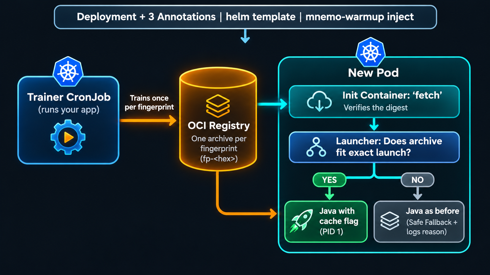

<div align="center">
  
  <h1>mnemo-warmup</h1>
</div>

<div align="center">

<b>Faster Java pod starts on Kubernetes, without GraalVM.</b>

<p>
Java services spend their first seconds loading and linking classes, on every deployment, scale-up and node move.
mnemo-warmup trains an AppCDS or Project Leyden AOT cache <b>once, inside your cluster</b>, and gives it to every replica of your
unchanged JVM application. A pod starts from the cache when it fits its launch exactly, and starts the ordinary way when it does not.
</p>

<a href="https://github.com/baokhang83/mnemo-warmup/actions/workflows/build.yml"></a>
<a href="https://baokhang83.github.io/mnemo-warmup/"></a>
<a href="LICENSE"></a>


<p>
<a href="#try-the-example">Try the example</a> &middot;
<a href="#quick-start-in-three-steps">Quick start</a> &middot;
<a href="#measurements">Measurements</a> &middot;
<a href="docs/reference.md">Reference</a>
</p>

</div>

## Key benefits

- **Shorter JVM start-up, no rewrite.** Keep your JDK, your frameworks and your JAR. Pods start from a ready-made class cache instead of loading every class from scratch. Pod readiness improves where class loading dominates the start (Spring Boot: [-40%](#measurements)); [measure](docs/operations.md#measure-the-benefit) yours.
- **Three annotations, no source changes.** An injector adds the init containers, the launcher and the trainer to a plain Deployment, and you can preview every change first.
- **A cache problem never stops a pod.** A missing, outdated, damaged or unreachable cache means an ordinary start, and the log says why.
- **Set it up once.** When the image or JVM options change, the trainer builds a new cache by itself.
- **Fits what you already run.** An OCI registry you already have, Helm, and `java` stays PID 1. No controller, webhook or CRD. Works on distroless images.
- **AppCDS or the AOT cache**, chosen from your image's JDK (AppCDS on 21 and later, Leyden AOT on 25).

## How it works

<div align="center">
  
</div>

- A **fingerprint** identifies what a cache is valid for: the JDK build, the classpath JAR contents and the JVM options.
- The **trainer** is a CronJob that runs your application image once per new fingerprint, stores the cache in the registry, and takes a Kubernetes Lease so only one trainer works at a time.
- Each **pod** gets its tools (two init containers, or a read-only `image` volume on clusters that support it) and starts through a small static launcher. When the image or JVM options change, a new fingerprint is trained.

> **Status: alpha.** Command-line options, annotations, chart values and the manifest format may still change. Validate both the benefit and the deployment behaviour with your own workload before you rely on it. [What has and has not been verified](docs/operations.md#known-limitations).

## Try the example

Run the bundled Spring Boot application through the whole annotated path on a throw-away [kind](https://kind.sigs.k8s.io/) cluster, on a Temurin and on a distroless Java image:

```bash
git clone --depth 1 --branch v0.2.5 https://github.com/baokhang83/mnemo-warmup.git mnemo-warmup-src
cd mnemo-warmup-src
scripts/e2e-kind-inject.sh temurin     # needs docker, kind, kubectl, Helm 3, Java 21+ and Maven; several minutes
```

It previews and installs an annotated Deployment, shows it starting without a cache, trains one, restarts the pods onto it, changes a JVM option, corrupts the stored archive, stops the registry, and removes everything, checking at each step that the application still starts. See [`examples/`](examples/README.md).

## Quick start in three steps

**Before you start:** the CLI runs on your machine for the preview and as the Helm post-renderer. It needs Java 21 or newer and comes in the tools image (the same one the injected init containers use):

```bash
docker run --rm -v "$PWD":/out --entrypoint cp ghcr.io/baokhang83/mnemo-warmup-tools:0.2.5 -r /opt/mnemo-warmup /out/
export PATH="$PWD/mnemo-warmup/bin:$PATH"
mnemo-warmup --version
```

Helm 3 calls an executable as the post-renderer. Save this as `mnemo-warmup-inject` and `chmod +x` it:

```sh
#!/bin/sh
exec mnemo-warmup inject "$@"
```

### Step 1: annotate the Deployment

Add three annotations to the Deployment's **pod template**, and give the container an explicit Java command (`java [options] -jar <jar> [args]`):

```yaml
spec:
  template:
    metadata:
      annotations:
        warmup.mnemo.io/enabled: "true"
        warmup.mnemo.io/store: "oci://registry.example.com/team/my-app-warmup"
        warmup.mnemo.io/exit-mode: "spring-refresh"     # or http-probe, with warmup.mnemo.io/probe-url
    spec:
      containers:
        - name: app
          image: registry.example.com/team/my-app:1.4.2
          command: ["java"]
          args: ["-Xmx512m", "-jar", "/app/app.jar"]
```

The store is a repository for caches, not for your application image. [Every annotation and override](docs/configuration.md#annotations).

### Step 2: preview

```bash
helm template my-app ./my-chart --namespace my-namespace \
  | mnemo-warmup inject --namespace my-namespace --preview
```

The preview names the application container, image and JAR, the store, the trainer mode, and what the trainer copies from your workload (environment variable names, `envFrom` names, volumes and mounts, **never values**), then lists the Kubernetes fields it would add or change. The trainer starts your application with that configuration, so read it. A launch the injector cannot handle is reported here with the reason, and nothing is changed.

### Step 3: deploy

```bash
helm upgrade --install my-app ./my-chart --namespace my-namespace \
  --post-renderer ./mnemo-warmup-inject \
  --post-renderer-args=--namespace=my-namespace
```

The injector adds the install and fetch init containers, starts your application through the launcher, and adds a trainer CronJob with its ServiceAccount and Role. Your application's source does not change. With Helm 4, or without Helm, pipe `helm template` through `mnemo-warmup inject` and apply the result ([details](docs/offline-injector.md)).

> **Spring Boot:** the trainer and every pod must run the same JAR files, so extract the Spring Boot JAR when you build the image. [Preparing the image](docs/configuration.md#spring-boot), with a distroless example.

### Then: train and check that it works

The trainer runs every 10 minutes. To train now and check the result:

```bash
kubectl -n my-namespace get cronjob
kubectl -n my-namespace create job first-train --from=cronjob/<trainer-cronjob>
kubectl -n my-namespace wait --for=condition=complete job/first-train --timeout=15m
kubectl -n my-namespace logs job/first-train -c trainer                   # train: TRAINED ...
kubectl -n my-namespace rollout restart deployment/my-app
kubectl -n my-namespace logs <new-pod> -c mnemo-warmup-fetch               # Archive: ... (APP_CDS)
```

A selected archive shows the integration works. It does **not** show that pods became ready faster: [measure the whole start](docs/operations.md#measure-the-benefit).

## Registry authentication

The trainer needs read and write access to the archive repository, the pods read-only access. Use Docker-config Secrets (`warmup.mnemo.io/pull-secret`, `push-secret`) for registries with Basic or Bearer login. On **Amazon EKS**, pods can use IAM roles for service accounts to get an ECR login with no stored password. Both are in [registry authentication](docs/registry-auth.md) and the [EKS and ECR guide](docs/aws-workload-identity.md); the ECR path has not yet been verified on a live cluster.

## Minimal and distroless images

The injector supports Java images without `/bin/sh`, including distroless ones: every generated step runs a static launcher copied into the pod. It supports launches of the form `java [JVM options] -jar <jar> [arguments]`. The preview reports anything else with the reason. The bundled example is built and run on `gcr.io/distroless/java21-debian12` in the end-to-end test.

## Requirements

- Kubernetes with CronJobs and the Lease API; `Deployment` workloads.
- An application image with Java 21 or newer and a supported `java ... -jar ...` launch.
- An OCI registry reachable from the cluster, with the permissions above.
- The same JAR files in the trainer and in every pod.
- A workload whose startup can safely run once more in a separate trainer pod.

Details and what is not supported: [configuration](docs/configuration.md#requirements).

## Operational considerations

- **Training starts a real instance of your application.** Connections, migrations and scheduled jobs may run. Review the preview.
- **The first pods start uncached.** Training is asynchronous; later pods use the archive.
- **Caches use registry storage, and nothing deletes them.** Set a [retention policy](docs/archive-retention.md) on the archive repository.
- **Cache problems fall back; deployment problems do not.** A missing, damaged or unreachable archive means an ordinary start. A missing Secret, an unpullable image or a wrong command can still keep a pod from starting: [what can still stop a pod](docs/operations.md#what-can-still-stop-a-pod).

## Measurements

**Will it make my pods start faster?** It depends on what your app does while it starts. We measured four application profiles (12 restarts each; 1 CPU and 1 GiB except SonarQube at 2 CPUs and 3 GiB).

| Workload Profile | Pod start-to-Ready | Verdict |
|---|---|---|
| 🟢 **Spring Boot**: start-up is mostly loading classes and creating beans | **5 s → 3 s**<br>40% faster | **Worth it.** The JVM itself starts 41% faster. |
| 🟡 **Small Spring Boot example**: 31 JARs, 20 MiB | **2.5 s → 2 s** | **Uncertain.** The ranges overlap at the one-second measurement resolution. |
| 🟡 **Jenkins**: start-up is mostly the application running its own setup code (initializing plugins and configuration) | **4 s → 4 s**<br>no change | **Neutral.** The JVM starts 13% faster, the pod is ready at the same time. |
| 🔴 **SonarQube**: the container starts a small launcher, which starts three other JVMs that do the real work | **15 s → 17 s**<br>13% slower | **Not a fit yet.** The cache only reaches the launcher ([#77](https://github.com/baokhang83/mnemo-warmup/issues/77)). |

**The rule of thumb:** the more of your start-up is class loading (typical for Spring Boot and similar frameworks), the more you gain. If it is mostly your own initialization code, or a launcher that starts other JVMs, expect little or nothing.

> **Use the `image` volume where your cluster supports it.** The green and yellow rows deliver the tools as a Kubernetes [`image` volume](docs/configuration.md#tools-delivery-init-containers-or-an-image-volume), which needs no init containers for these runs (no pull Secret). With init containers the Spring Boot pod is ready in 5 s either way (the init containers cost what the cache saves), and Jenkins is 1 s slower. The red row used init containers.

Numbers are medians and pod times have a one-second resolution: read the direction, not the decimals. Measure your own app with `mnemo-warmup bench --jar app.jar` or [the cluster method](docs/operations.md#measure-the-benefit). Method, raw data and limits: [benchmarks](benchmarks/README.md). More studies (JDK 21 vs 25, app size, scale-out, alternatives) are planned for the [0.3.0 beta](https://github.com/baokhang83/mnemo-warmup/milestone/3).

## Disable or remove it

Remove the `warmup.mnemo.io/*` annotations (or set `enabled` to `"false"`) and redeploy through the injector. The next render has your original command and no init containers, and Helm removes the generated trainer resources. Archives stay in the registry until your retention policy removes them. [Details](docs/operations.md#disable-or-remove-it).

## Other ways in

The explicit Helm-subchart setup (you wire the helpers into your own templates; needs `/bin/sh` in the image) is in [docs/helm-chart.md](docs/helm-chart.md).

## Documentation

- [Configuration and requirements](docs/configuration.md): annotations, overrides, Spring Boot.
- [Registry authentication](docs/registry-auth.md) and [EKS and ECR](docs/aws-workload-identity.md)
- [Operating it](docs/operations.md) and [archive retention](docs/archive-retention.md)
- [Offline injector](docs/offline-injector.md): preview, Helm and GitOps use, what was verified.
- [Reference](docs/reference.md): every command and option.
- For LLM tools: [llms.txt](https://baokhang83.github.io/mnemo-warmup/llms.txt) and [llms-full.txt](https://baokhang83.github.io/mnemo-warmup/llms-full.txt) (published with every build).
- [Example](examples/README.md), [Helm chart setup](docs/helm-chart.md), [design decisions](docs/adr/) and the [project plan](docs/PLAN.md).
- Related: [`mnemo-jvm-warden`](https://github.com/baokhang83/mnemo-jvm-warden) resizes running pods in place; the planned integration is that warden injects the init containers (not built yet). `warmup-core` is on Maven Central (`io.github.baokhang83.mnemo:warmup-core`).

## Building from source

Requirements: JDK 21+ and Maven 3.9+. The code compiles with `--release 21` and is tested
on JDK 25.

```bash
mvn verify
java -jar warmup-cli/target/mnemo-warmup.jar --version
java -jar warmup-cli/target/mnemo-warmup.jar build --help
```

The build produces a self-contained `warmup-cli/target/mnemo-warmup.jar`; the examples above
call it as `mnemo-warmup`.

## Contributing

The project is at a very early stage and the design is still moving. Issues and
discussion about the open decisions in the plan are the most useful contribution right
now.

## License

Apache License 2.0. See [LICENSE](LICENSE).
