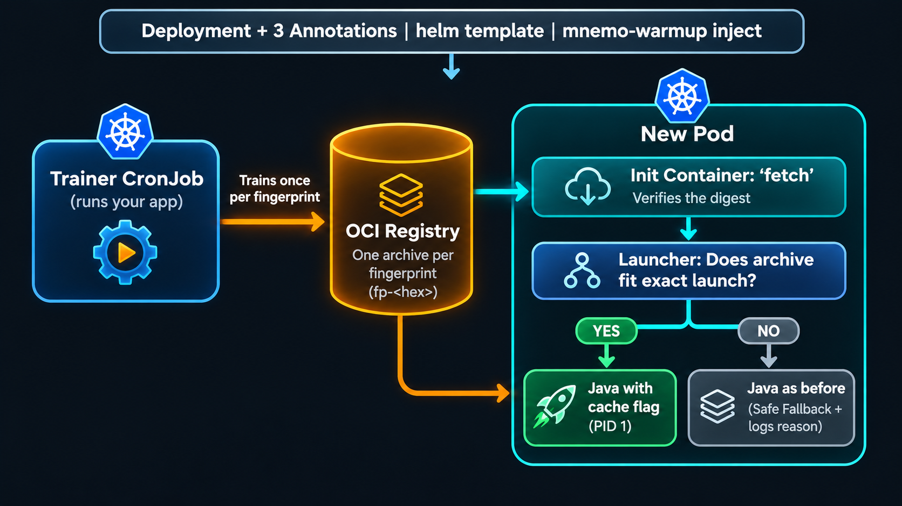

<div align="center">
  
  <h1>mnemo-warmup</h1>
</div>

<div align="center">

<b>Faster Java pod starts on Kubernetes, without GraalVM.</b>

<p>
Java services spend their first seconds loading and linking classes, on every deployment, scale-up and node move.
mnemo-warmup trains an AppCDS or Project Leyden AOT cache <b>once, inside your cluster</b>, and gives it to every replica of your
unchanged JVM application. A pod starts from the cache when it fits its launch exactly, and starts the ordinary way when it does not.
</p>

<a href="https://github.com/baokhang83/mnemo-warmup/actions/workflows/build.yml"></a>
<a href="https://baokhang83.github.io/mnemo-warmup/"></a>
<a href="LICENSE"></a>


<p>
<a href="#try-it-on-your-own-jar">Try it</a> &middot;
<a href="#quick-start-in-three-steps">Quick start</a> &middot;
<a href="#why-not-x">Why not X?</a> &middot;
<a href="#measurements">Measurements</a> &middot;
<a href="docs/reference.md">Reference</a> &middot;
<a href="https://baokhang83.github.io/mnemo-warmup/">Docs site</a>
</p>

</div>

## Results

In our [GKE study](benchmarks/workload-tiers/results/gke-repaired.md) on JDK 25 with the Leyden AOT cache, pods of four Spring Boot workloads reached Ready **31%–58% faster after application start**:

| Workload | Archive size | Uncached app-start to Ready | Cached app-start to Ready | Improvement |
| :--- | ---: | ---: | ---: | ---: |
| **Minimal service** (37 JARs) | 54.3 MiB | 4.5 s | 2.0–2.1 s | **53%–56%** |
| **Standard service** (70 JARs) | 103.9 MiB | 7.4 s | 3.1–4.2 s | **44%–58%** |
| **Larger service** (98 JARs) | 116.0 MiB | 8.7 s | 3.9–5.0 s | **42%–55%** |
| **ThingsBoard CE** (458 JARs) | 223.5 MiB | 30.8 s | 21.2–21.4 s | **~31%** |

Single-pod trials; scheduling and archive fetch are excluded. [Method, limits and other workloads](#measurements).

## How simple it is

Add three annotations to the pod template of a Deployment that starts with `java ... -jar`:

```diff
 spec:
   template:
     metadata:
+      annotations:
+        warmup.mnemo.io/enabled: "true"
+        warmup.mnemo.io/store: "oci://registry.example.com/team/my-app-warmup"   # a cache-only repository
+        warmup.mnemo.io/exit-mode: "spring-refresh"     # or http-probe, with warmup.mnemo.io/probe-url
     spec:
       containers:
         - name: app
           image: registry.example.com/team/my-app:1.4.2
           command: ["java"]
           args: ["-Xmx512m", "-jar", "/app/app.jar"]
```

Deploy it through the injector, and it adds the trainer, the init containers and the launcher for you. Your source code does not change; a Spring Boot image only needs its [JAR extracted](docs/configuration.md#spring-boot). The store is a repository in your registry that holds only caches ([choosing the store](docs/configuration.md#choosing-the-store)). [Quick start](#quick-start-in-three-steps).

## Key benefits

- **Shorter JVM start-up, no rewrite.** Keep your JDK, your frameworks and your JAR. Pods start from a ready-made class cache instead of loading every class from scratch; [measure](docs/operations.md#measure-the-benefit) the gain for yours.
- **Three annotations, no source changes.** An injector adds the init containers, the launcher and the trainer to a plain Deployment, and you can preview every change first.
- **A cache problem never stops a pod.** A missing, outdated, damaged or unreachable cache means an ordinary start, and the log says why.
- **Optional node-local archive cache.** Reuse verified archive bytes across pods on the same node; if the cache is unavailable, fetch directly from the registry. [Setup and trust requirements](deploy/helm/mnemo-nodecache/README.md).
- **Set it up once.** When the image or JVM options change, the trainer builds a new cache by itself.
- **Fits what you already run.** An OCI registry you already have, Helm, and `java` stays PID 1. No controller, webhook or CRD. Works on distroless images.
- **AppCDS or the AOT cache**, chosen from your image's JDK (AppCDS on 21 and later, Leyden AOT on 25).

## How it works

<div align="center">
  
</div>

- A **fingerprint** identifies what a cache is valid for: the JDK build, the classpath JAR contents and the JVM options.
- The **trainer** is a CronJob that runs your application image once per new fingerprint, stores the cache in the registry, and takes a Kubernetes Lease so only one trainer works at a time.
- Each **pod** gets its tools (two init containers, or a read-only `image` volume on clusters that support it) and starts through a small static launcher. When the image or JVM options change, a new fingerprint is trained.

## Why not X?

Each of these makes Java start faster. They differ in what you have to change and what your cluster has to allow.

| | What you change | What runs | Extra pod privileges | Startup gain |
| :--- | :--- | :--- | :--- | :--- |
| **GraalVM Native Image** | A native build, plus reachability metadata for reflection, proxies and resources | A native executable, not a JVM | None | Typically the largest |
| **CRaC** | A CRaC-enabled JDK, and code that closes and reopens files and sockets around the checkpoint | A restored process snapshot | CRIU needs `CAP_CHECKPOINT_RESTORE` and `CAP_SYS_PTRACE`, or a privileged pod | Large |
| **Spring Boot CDS / AOT cache** | A training run in your image build, kept in step with the runtime JDK, JARs and JVM options | Your JVM | None | Moderate |
| **mnemo-warmup** | Three annotations and an explicit `java -jar` command (Spring Boot: an [extracted JAR](docs/configuration.md#spring-boot)); no source changes | Your JVM | None: training pods run under Pod Security `restricted` | Moderate: [31%–58% in our GKE study](#results) |

mnemo-warmup uses the same JVM feature as Spring Boot's CDS support. The difference is where training happens: in your cluster, with your workload's configuration, and again by itself whenever the image or JVM options change, with no change to your build pipeline. It is not limited to Spring Boot. If you need the fastest possible start and can take on a native build, Native Image goes further.

## Try it on your own JAR

All you need is Java 21 or newer. No Docker, no cluster. Install the CLI and point it at a Spring Boot JAR you already have:

```bash
curl -fsSL https://raw.githubusercontent.com/baokhang83/mnemo-warmup/main/scripts/install.sh | sh
export PATH="$HOME/.local/bin:$PATH"
mnemo-warmup bench --jar path/to/app.jar
```

It trains an AppCDS cache, plus an AOT cache on JDK 25, then starts your app in fresh JVMs and prints the median start time with each. It starts your app about 15 times, so it takes about 15 of your app's startups: 7 seconds for the bundled example on JDK 25, which went from 507 ms with no cache to 283 ms with the AOT cache on one laptop. For other frameworks, add `--exit-mode http-probe --url http://localhost:8080/health`. [All options](docs/reference.md#measure-the-savings-bench).

## Try the full Kubernetes path

Run the bundled Spring Boot application through the whole annotated path on a throw-away [kind](https://kind.sigs.k8s.io/) cluster, on a Temurin and on a distroless Java image:

```bash
git clone --depth 1 --branch v0.2.5 https://github.com/baokhang83/mnemo-warmup.git mnemo-warmup-src
cd mnemo-warmup-src
scripts/e2e-kind-inject.sh temurin     # needs docker, kind, kubectl, Helm 3, Java 21+ and Maven; several minutes
```

It previews and installs an annotated Deployment, shows it starting without a cache, trains one, restarts the pods onto it, changes a JVM option, corrupts the stored archive, stops the registry, and removes everything, checking at each step that the application still starts. See [`examples/`](examples/README.md).

## Quick start in three steps

Install the CLI on macOS or Linux (requires Java 21+):

```bash
curl -fsSL https://raw.githubusercontent.com/baokhang83/mnemo-warmup/main/scripts/install.sh | sh
export PATH="$HOME/.local/bin:$PATH"
mnemo-warmup --version
```

See the [installer source](scripts/install.sh) and [installation options](docs/configuration.md#cli-installation-options).

Helm 3 calls an executable as the post-renderer. Save this as `mnemo-warmup-inject` and `chmod +x` it:

```sh
#!/bin/sh
exec mnemo-warmup inject "$@"
```

### Step 1: annotate the Deployment

Add the three annotations from [How simple it is](#how-simple-it-is) to the Deployment's **pod template**, and give the container an explicit Java command (`java [options] -jar <jar> [args]`).

The store is a repository for caches, not for your application image: for `registry.example.com/team/my-app`, use `oci://registry.example.com/team/my-app-warmup`. [Choosing the store](docs/configuration.md#choosing-the-store) and [every annotation and override](docs/configuration.md#annotations).

### Step 2: preview

```bash
helm template my-app ./my-chart --namespace my-namespace \
  | mnemo-warmup inject --namespace my-namespace --preview
```

The preview names the application container, image and JAR, the store, the trainer mode, and what the trainer copies from your workload (environment variable names, `envFrom` names, volumes and mounts, **never values**), then lists the Kubernetes fields it would add or change. The trainer starts your application with that configuration, so read it. A launch the injector cannot handle is reported here with the reason, and nothing is changed.

### Step 3: deploy

```bash
helm upgrade --install my-app ./my-chart --namespace my-namespace \
  --post-renderer ./mnemo-warmup-inject \
  --post-renderer-args=--namespace=my-namespace
```

The injector adds the install and fetch init containers, starts your application through the launcher, and adds a trainer CronJob with its ServiceAccount and Role. Your application's source does not change. With Helm 4, or without Helm, pipe `helm template` through `mnemo-warmup inject` and apply the result ([details](docs/offline-injector.md)).

> **Spring Boot:** the trainer and every pod must run the same JAR files, so extract the Spring Boot JAR when you build the image. [Preparing the image](docs/configuration.md#spring-boot), with a distroless example.

### Then: train and check that it works

The trainer runs every 10 minutes. To train now and check the result:

```bash
kubectl -n my-namespace get cronjob
kubectl -n my-namespace create job first-train --from=cronjob/<trainer-cronjob>
kubectl -n my-namespace wait --for=condition=complete job/first-train --timeout=15m
kubectl -n my-namespace logs job/first-train -c trainer                   # train: TRAINED ...
kubectl -n my-namespace rollout restart deployment/my-app
kubectl -n my-namespace logs <new-pod> -c mnemo-warmup-fetch               # Archive: ... (APP_CDS)
```

A selected archive shows the integration works. To see how much sooner your pods become ready, [measure the whole start](docs/operations.md#measure-the-benefit).

## Registry authentication

The trainer needs read and write access to the archive repository, the pods read-only access. Use Docker-config Secrets (`warmup.mnemo.io/pull-secret`, `push-secret`) for registries with Basic or Bearer login. On **Amazon EKS**, pods can use IAM roles for service accounts to get an ECR login with no stored password. Both are in [registry authentication](docs/registry-auth.md) and the [EKS and ECR guide](docs/aws-workload-identity.md).

## Minimal and distroless images

The injector supports Java images without `/bin/sh`, including distroless ones: every generated step runs a static launcher copied into the pod. It supports launches of the form `java [JVM options] -jar <jar> [arguments]`. The preview reports anything else with the reason. The bundled example is built and run on `gcr.io/distroless/java21-debian12` in the end-to-end test.

## Requirements

- Kubernetes with CronJobs and the Lease API; `Deployment` workloads.
- An application image with Java 21 or newer and a supported `java ... -jar ...` launch.
- An OCI registry reachable from the cluster, with the permissions above.
- The same JAR files in the trainer and in every pod.
- A workload whose startup can safely run once more in a separate trainer pod.

Details and what is not supported: [configuration](docs/configuration.md#requirements).

## Operational considerations

- **It is beta.** Command-line options, annotations, chart values and the manifest format may still change. Validate both the benefit and the deployment behaviour with your own workload before you rely on it: [what has and has not been verified](docs/operations.md#known-limitations). The EKS and ECR path has not yet been verified on a live cluster.
- **Training starts a real instance of your application.** Connections, migrations and scheduled jobs may run. Review the preview.
- **The first pods start uncached.** Training is asynchronous; later pods use the archive.
- **Caches use registry storage, and nothing deletes them.** Set a [retention policy](docs/archive-retention.md) on the archive repository.
- **Whoever can push to the archive repository can run code in your pods, unless you sign.** Archives are checked for integrity; [signing them](docs/configuration.md#signed-archives-opt-in) (opt-in) also checks who published them. Either way, use a repository per application, pull-only pod credentials and TLS: [trust model](docs/security.md#trust-model-who-can-publish-an-archive).
- **Cache problems fall back; deployment problems do not.** A missing, damaged or unreachable archive means an ordinary start. A missing Secret, an unpullable image or a wrong command can still keep a pod from starting: [what can still stop a pod](docs/operations.md#what-can-still-stop-a-pod).

## Measurements

**Will it make my pods start faster?** Startup gains depend on your application's architecture.

The [results at the top](#results) come from our [GKE JDK 25 Leyden AOT workload-tier study](benchmarks/workload-tiers/results/gke-repaired.md). They are reductions in app-start-to-Ready time; scheduling and archive fetch are excluded. Each cell was measured once, and the original watch observations have limitations described in the report.

**Key takeaways:**

- **Framework-heavy apps can benefit:** In local `kind` tests, Spring Boot had a **1 s (~20%) median paired readiness improvement** with [image volumes](docs/configuration.md#tools-delivery-init-containers-or-an-image-volume); its reported application startup was **3.18 s → 1.90 s**. Init-container overhead eliminated the readiness savings.
- **Other startup work can dominate:** Jenkins reached Ready at about the same time, while SonarQube slowed down in the test because its child JVMs did not use the cache ([#77](https://github.com/baokhang83/mnemo-warmup/issues/77)).
- **Image volumes avoid init-container overhead:** Use them where the cluster supports them.

Run `mnemo-warmup bench --jar app.jar` or use the [cluster method](docs/operations.md#measure-the-benefit). See [benchmarks](benchmarks/README.md) for methodology and limitations; the alternatives comparison is planned in [#74](https://github.com/baokhang83/mnemo-warmup/issues/74).

## Disable or remove it

Remove the `warmup.mnemo.io/*` annotations (or set `enabled` to `"false"`) and redeploy through the injector. The next render has your original command and no init containers, and Helm removes the generated trainer resources. Archives stay in the registry until your retention policy removes them. [Details](docs/operations.md#disable-or-remove-it).

## Other ways in

The explicit Helm-subchart setup (you wire the helpers into your own templates; needs `/bin/sh` in the image) is in [docs/helm-chart.md](docs/helm-chart.md).

## Documentation

- [Configuration and requirements](docs/configuration.md): annotations, overrides, Spring Boot.
- [Security and blast radius](docs/security.md): RBAC scope, secret isolation, registry permissions, and fail-safe execution.
- [Registry authentication](docs/registry-auth.md) and [EKS and ECR](docs/aws-workload-identity.md)
- [Operating it](docs/operations.md) and [archive retention](docs/archive-retention.md)
- [Offline injector](docs/offline-injector.md): preview, Helm and GitOps use, what was verified.
- [Reference](docs/reference.md): every command and option.
- For LLM tools: [llms.txt](https://baokhang83.github.io/mnemo-warmup/llms.txt) and [llms-full.txt](https://baokhang83.github.io/mnemo-warmup/llms-full.txt) (published with every build).
- [Example](examples/README.md), [Helm chart setup](docs/helm-chart.md), [design decisions](docs/adr/) and the [project plan](docs/PLAN.md).

## Building from source

Requirements: JDK 21+ and Maven 3.9+. The code compiles with `--release 21` and is tested
on JDK 25.

```bash
mvn verify
java -jar warmup-cli/target/mnemo-warmup.jar --version
java -jar warmup-cli/target/mnemo-warmup.jar build --help
```

The build produces a self-contained `warmup-cli/target/mnemo-warmup.jar`; the examples above
call it as `mnemo-warmup`.

## Contributing

The project is still at an early stage and the design is still moving. Issues and
discussion about the open decisions in the plan are the most useful contribution right
now.

## Articles

* [Faster Java Pod Startups Without GraalVM: Why AppCDS Needs Kubernetes Image Volumes](https://baokhang.hashnode.dev/faster-java-pod-startups-without-graalvm-appcds-kubernetes-image-volumes)
* [Can JVM caches speed up Spring Boot on Kubernetes? A JDK 21 and JDK 25 study](https://baokhang.hashnode.dev/can-jvm-caches-speed-up-spring-boot-on-kubernetes-a-jdk-21-and-jdk-25-study)
* [31% to 58% Faster Java Pods on Kubernetes: Benchmarking JDK 25 Leyden AOT from Microservices to a 458-JAR Monolith](https://baokhang.hashnode.dev/31-to-58-faster-java-pods-on-kubernetes-benchmarking-jdk-25-leyden-aot-from-microservices-to-a-458-jar-monolith)

## License

Apache License 2.0. See [LICENSE](LICENSE).
