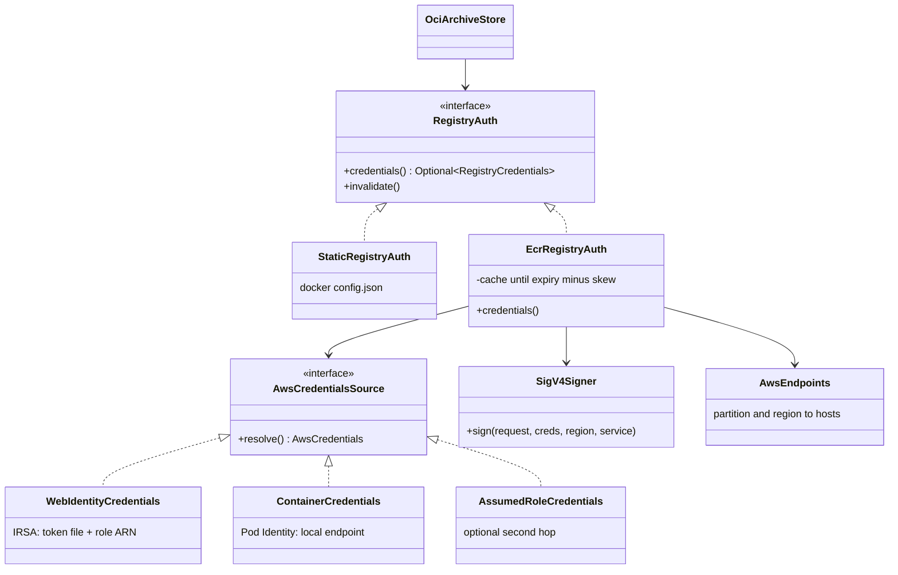
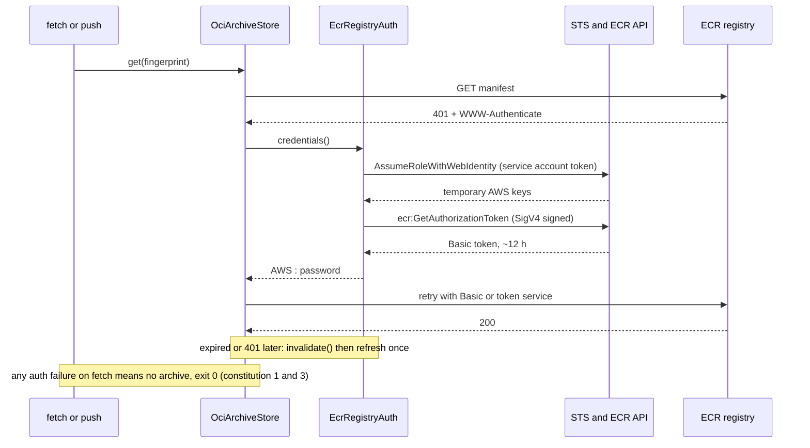

# Design: workload identity authentication for EKS and ECR (#57)

Registry login becomes a provider boundary. Today `OciArchiveStore` takes one fixed `RegistryCredentials` read from a docker-config file. After this change it asks a `RegistryAuth` for credentials each time it needs a registry token, so short-lived ECR tokens can expire and be refreshed mid-run. The static docker-config path stays as one provider. The EKS/ECR path is a second provider, hand-written over `java.net.http` (no AWS SDK), so `warmup-core` keeps zero runtime dependencies.

## Shapes

## Main flow: first pull on EKS

## Scope notes

- Fetch and trainer identities are separate: the CLI uses whatever identity its pod has. Least privilege is IAM policy plus two service accounts in the chart (pull-only vs push), documented, not coded.
- Provider selection: explicit `--registry-auth` file keeps today's behaviour; an `*.dkr.ecr.*.amazonaws.com*` host with AWS identity env present selects ECR; anything else is anonymous.
- Endpoint selection: partition (`aws`, `aws-cn`, `aws-us-gov`) and region come from the registry host, with `AWS_REGION` as fallback; STS uses the regional endpoint.
- Scope: IRSA (web identity) ships in this issue, with optional second-hop role assumption (`--aws-role-arn`). EKS Pod Identity (`ContainerCredentials`) is a follow-up behind the same `AwsCredentialsSource` interface.
- Credentials never reach logs; `toString()` redacts, errors name the step, not the secret.
- GKE and AKS providers are follow-up work; the `RegistryAuth` boundary is where they plug in.
