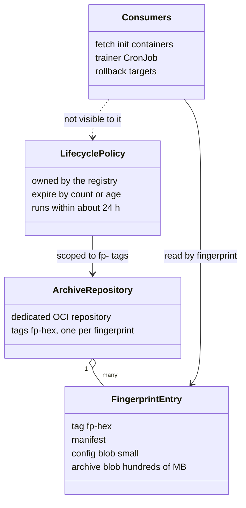
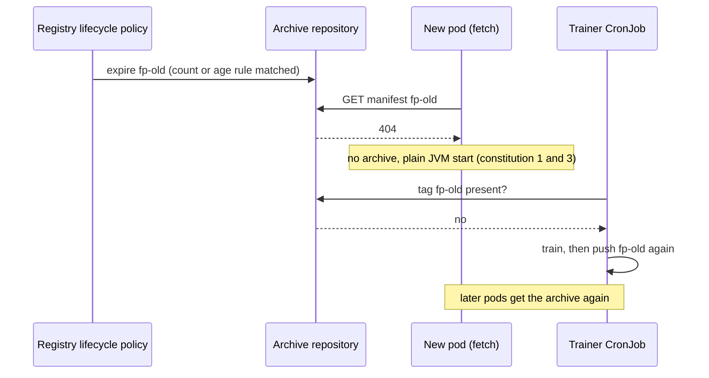

# Design: conservative OCI archive retention guidance (#58)

Documentation only. No deletion code, no delete permissions. The guide tells operators how to bound storage growth with the registry's own lifecycle policy, and what a deletion costs.

## Shapes

## What a deletion costs

## Scope notes

- Count-based rule (newest N by push time) is the conservative example. Age-based expiry does not know a version is running, and the guide says so.
- The ECR example is included because the policy format and rule evaluation are confirmed in AWS documentation; what the documentation does not state (OCI artifacts, re-pushed tags, in-use images, tag immutability) is listed as unverified.
- Out of scope: automatic deletion, a prune command, extra IAM actions, other registries' policy syntax.
