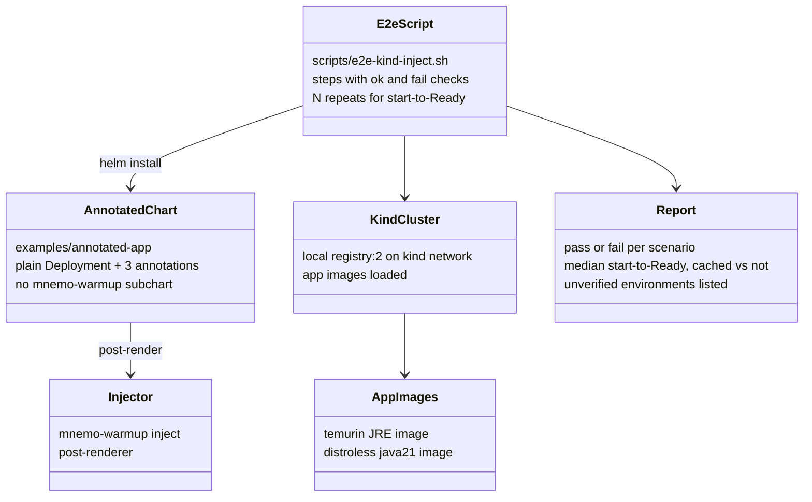
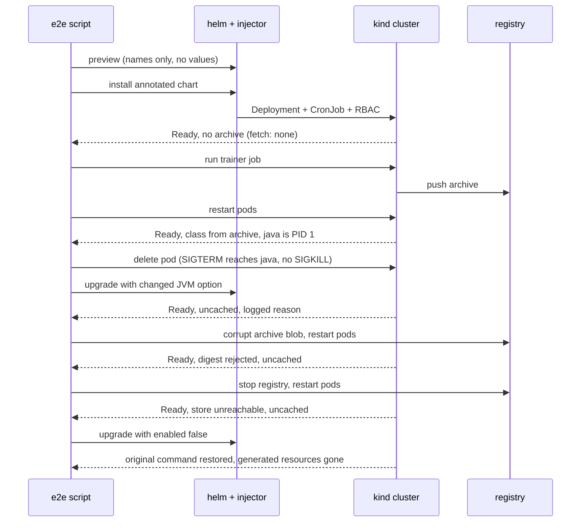

# Design: end-to-end verification of the annotated adoption path (#59)

A new script, `scripts/e2e-kind-inject.sh`, drives a plain annotated Deployment through the real adoption path on a kind cluster: `helm install --post-renderer` with the injector, an OCI registry as the archive store, the native launcher, and the trainer CronJob the injector generates. The existing `scripts/e2e-kind.sh` keeps covering the chart path.

## Shapes

## Scenario flow

## Scope notes

- Correctness is asserted in CI. Start-to-Ready is measured from pod conditions with repeats and reported, with no speed threshold (kind timings are noisy).
- Architectures: the local run is the host's (arm64 here). CI runs amd64 and arm64 runners; any environment not run is listed as unverified in the docs.
- Real EKS/ECR is not exercised by this script (no cluster available); the docs keep that marked unverified.
