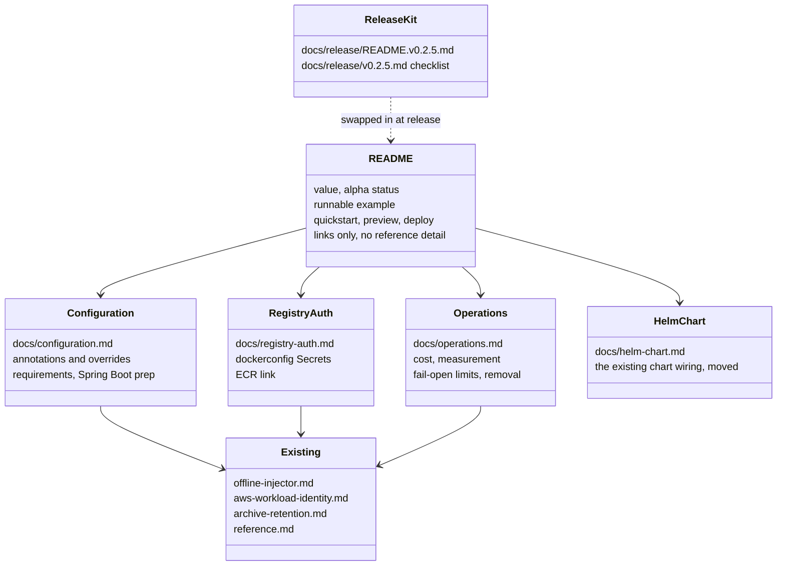
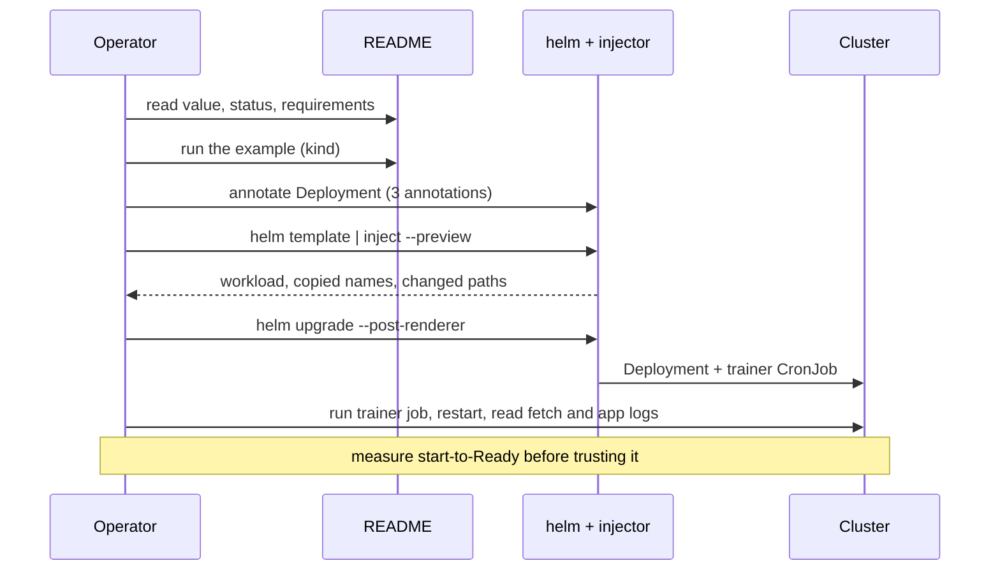

# Design: v0.2.5 adoption guide and configuration reference (#60)

Documentation only. The README is held on the released 0.2.0 chart path until v0.2.5 is tagged. The new pages and a ready-to-swap README are written now, with every command checked against the CLI built from `main`.

## Shapes

## Reader flow (quickstart)

## Scope notes

- The draft promised two annotations; the shipped injector requires three (`exit-mode` is mandatory). The docs say three and record the gap.
- Anything not shipped or not run is marked unverified (JDK 25 via the injector, real EKS/ECR, Helm 4, CI arm64 job).
