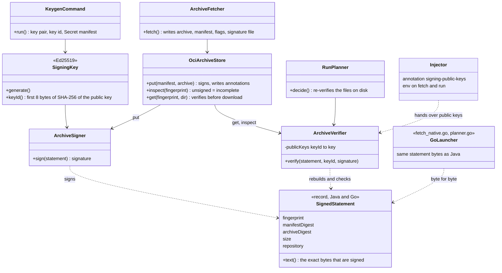
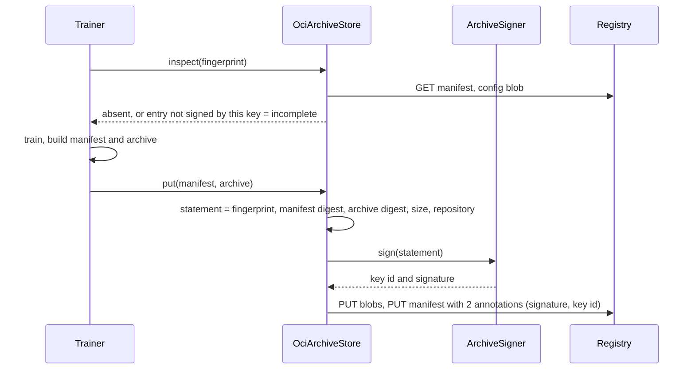
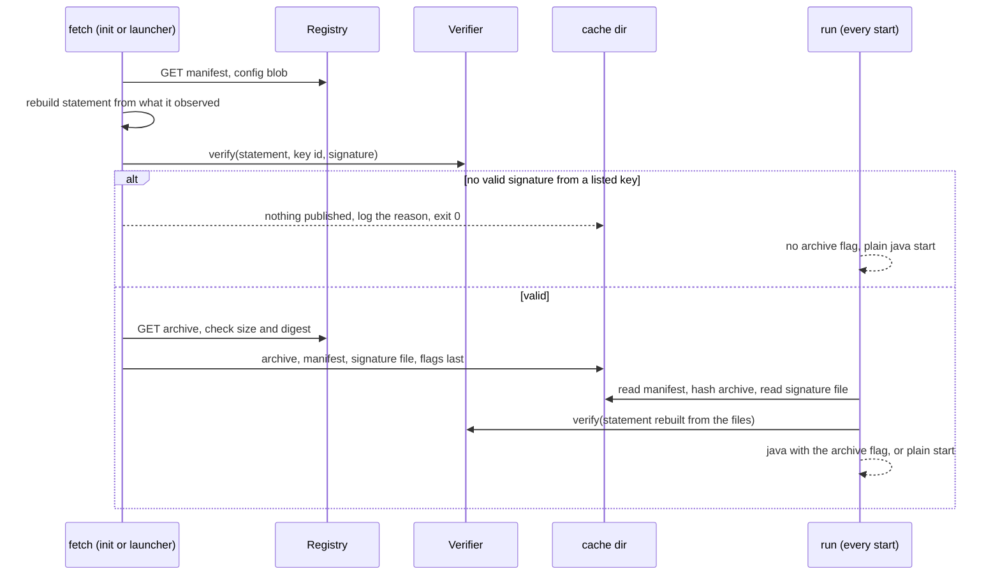

# Design: signed archives, stage A (#145)

Implements stage A of [ADR 0013](../../adr/0013-signed-archives.md). The trainer signs every archive it publishes with an Ed25519 private key. A pod that has been given the matching public key uses an archive only if its signature verifies; otherwise the archive is a **miss** and the pod starts without a cache. With no public key configured, nothing changes (opt-in).

Stage A protects against anyone who can write to the registry but does not hold the private key. It does not protect against code running inside the trainer container; that is stage B.

## Shapes

## Publish (trainer)

## Pod start (fetch, then run)

## Build order (each is one reviewable PR)

1. **The statement and shared test vectors.** `SignedStatement` in Java and Go, with a fixed-key vector (Ed25519 is deterministic) that both must reproduce byte for byte. This is the contract everything else stands on.
2. **Keys.** Key id, `ArchiveSigner`, `ArchiveVerifier`, `mnemo-warmup keygen`.
3. **The store.** `put` signs; `inspect` treats an entry not signed by the trainer's key as incomplete; `get` verifies. The Java fetch writes the config blob unchanged and a signature file.
4. **Java `run`** re-verifies the files on disk.
5. **Go `fetch` and `run`** verify, using the same vectors.
6. **Wiring and proof.** Injector annotation, chart value, preview, docs, a kind scenario with a tampered archive.

## Constitution check

- §1 and §3: a missing or invalid signature is a miss, the pod starts and the helper exits 0.
- §2: amended to "digest-checked, and signature-checked when keys are configured".
- §4: the JDK's built-in Ed25519 and Go's `crypto/ed25519`. No dependency is added.
