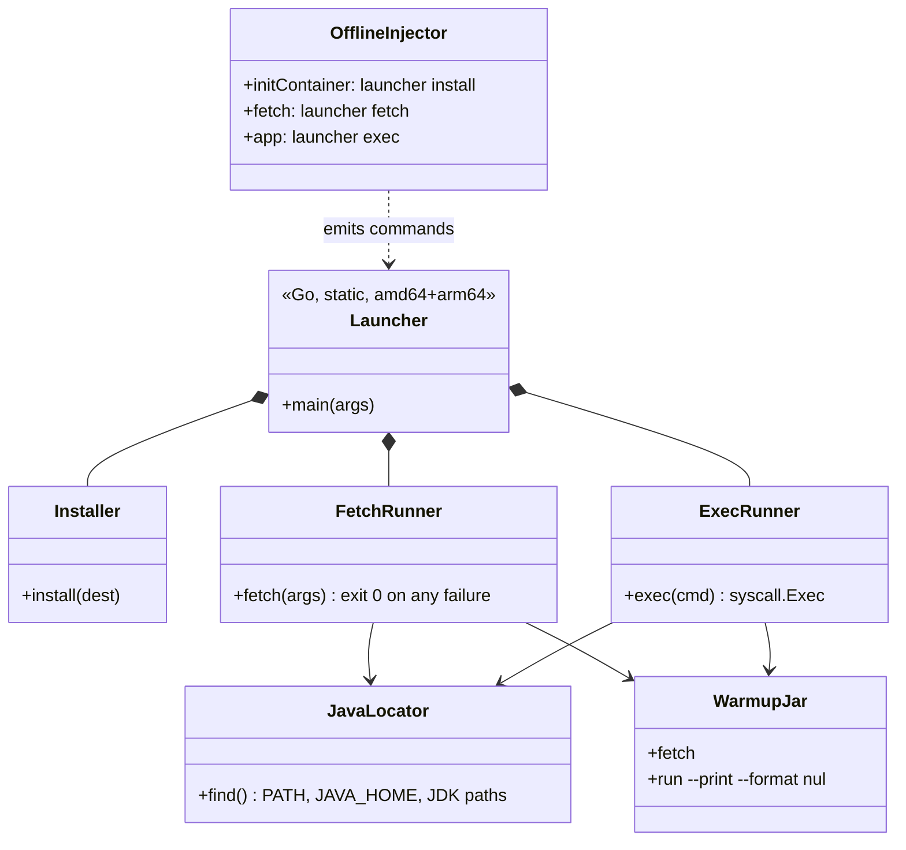
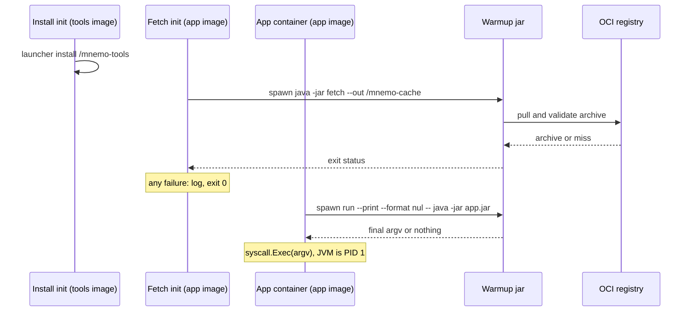

# Design: shell-free native launcher for distroless images (#56)

A static Go binary, `bin/mnemo-launcher`, replaces the shell for install, fetch and app start. The Java CLI keeps all cache logic; the launcher locates `java`, runs the jar, and replaces itself with the final command. The `sh` scripts and the busybox tools image stay for the Helm chart.

## Shapes

## Pod start

## Decisions to confirm

1. Keep the shell scripts and busybox base; add `bin/mnemo-launcher` beside them; the injector switches to it.
2. Add `run --print --format nul` so the launcher receives exact argv without `eval`.
3. No Java version probe in the launcher; a too-old `java` fails in the jar and takes the existing fallback.
